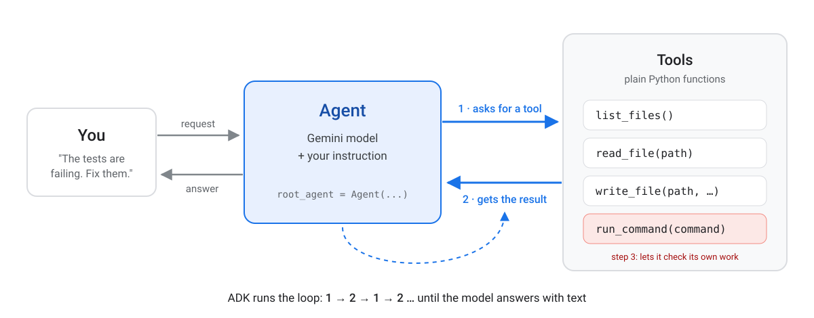

<!-- omarcevi.dev/workshops/coding-agent-workshop/ is built from this file. Code under a "source:" comment must match that file exactly (tests/test_guide.py). -->

# Build Your Coding Agent with Google ADK

A coding agent isn't magic. It's a model, a few tools and a loop. In this workshop you build one with Google's Agent Development Kit (ADK), one step at a time, until it can take a small Python project with failing tests and turn them green on its own.

[](images/agent-loop.svg)

*The whole idea in one picture. ADK runs the loop; you write the tools.*

You build it in four steps, each a few lines on top of the last:

1. **An agent with no tools.** A model and an instruction. It can talk about code, but it can't see yours.
2. **Give it hands.** Three Python functions to list, read and write files.
3. **Close the loop.** One more tool to run commands, so it can run the tests and check its own work.
4. **Add guardrails.** Keep it inside the project folder, and make it ask before it writes or runs anything.

Every step has a finished checkpoint in the repo, so you can't fall behind: copy the next one and keep going.

**What you need:** a Google Cloud project with billing (free trial credits work), and either a laptop with git and the gcloud CLI, or just a browser for Cloud Shell. Setup takes about 10 minutes.

## Setup

Do this before the workshop if you can. The agent calls Gemini through Vertex AI in your own Google Cloud project. You need a project with billing. Free trial credits work, and the whole workshop makes only a few dozen calls.

**Or use Cloud Shell, with nothing to install.** Click [Open in Cloud Shell](https://shell.cloud.google.com/cloudshell/editor?cloudshell_git_repo=https://github.com/omarcevi/coding_agent_workshop.git&cloudshell_git_branch=main&cloudshell_tutorial=tutorial.md&cloudshell_workspace=.&show=ide%2Cterminal). In the dialog, select **Trust repo** and click **Confirm**. Cloud Shell copies the repo and opens a tutorial panel next to the editor. It walks you through the setup and every step, and its links open the files for you.

Install the [gcloud CLI](https://cloud.google.com/sdk/docs/install), then sign in and select your project:

```bash
gcloud auth login
gcloud auth application-default login  # lets the agent call Vertex AI as you
gcloud config set project YOUR_PROJECT_ID
```

Get the code and run the setup script. On Windows, use Git Bash or WSL.

```bash
git clone https://github.com/omarcevi/coding_agent_workshop.git
cd coding_agent_workshop
bash scripts/setup.sh  # about a minute
```

The script checks the project and its billing, turns on the Vertex AI API, installs uv and the Python packages, writes `.env`, copies the buggy demo project into `workspace/`, and makes one call to Gemini. It ends with `✅ Ready`. ADK finds the one `.env` from every agent in the repo.

**No billing account?** Use a free key from [aistudio.google.com/apikey](https://aistudio.google.com/apikey) instead. Install [uv](https://docs.astral.sh/uv/getting-started/installation/), then:

```bash
uv sync
uv run reset_workspace.py
uv run python scripts/set_key.py  # asks for the key; it doesn't show on screen
```

Start the ADK dev UI:

```bash
uv run adk web --reload_agents agents
```

Open [localhost:8000](http://localhost:8000) and pick `my_agent` from **Select an app** at the top. `--reload_agents` picks up your code when you save, so you never restart it. Always start it with `uv run`, so the agent's `python -m pytest` uses this project's Python.

What's in the repo:

| Path | What it is |
|---|---|
| `agents/my_agent/` | Your agent. You build it up during the workshop. |
| `agents/step1_hello/` to `agents/step4_safe/` | The finished checkpoint for each step. |
| `demo_project/` | A tiny shopping cart with two bugs: three of its four tests fail. |
| `workspace/` | The agent's copy of `demo_project/`. The agents only touch this folder. |
| `reset_workspace.py` | Puts the original buggy project back in `workspace/`. |

## Step 1 · An agent with no tools

An ADK agent is a model plus an instruction. `adk web` looks for a variable called `root_agent` in `agent.py` and gives you a chat window for it. This is all of Step 1:

<!-- source: agents/step1_hello/agent.py -->
```python
from google.adk.agents import Agent

root_agent = Agent(
    name="coding_agent",
    model="gemini-3.8-flash",
    instruction="You are a helpful coding assistant.",
)
```

Your `agents/my_agent/agent.py` starts as exactly this. Pick `my_agent` in the dev UI and ask:

```text
The tests in my project are failing. Can you fix them?
```

It can't see your files. It asks you to paste the code, or it guesses a generic fix. Everything it says about your project is a guess.

**The idea:** a model has knowledge, but no eyes and no hands.

## Step 2 · Give it hands

Tools in ADK are plain Python functions. ADK reads each function's name, type hints and docstring, and sends them to the model as a tool definition. The model never runs your code: it asks for a call, ADK runs the function, and the result goes back to the model.

Start with the folder the agent works in, and a tool to see what's in it. Add `from pathlib import Path` at the top of the file.

<!-- source: agents/step2_files/agent.py -->
```python
# The folder the agent works in. Recreate it with: uv run reset_workspace.py
WORKSPACE = Path(__file__).resolve().parents[2] / "workspace"
SKIP = {"__pycache__", ".pytest_cache"}


def list_files() -> dict:
    """Lists every file in the project, as paths relative to the project root."""
    files = [
        str(p.relative_to(WORKSPACE))
        for p in sorted(WORKSPACE.rglob("*"))
        if p.is_file() and not SKIP & set(p.parts)
    ]
    return {"files": files}
```

Then a tool to read a file and one to write it. The docstrings are written for the model, not for you: they're all it knows about each tool.

<!-- source: agents/step2_files/agent.py -->
```python
# Tools return errors instead of raising them. ADK re-raises a tool's
# exception and ends the run, but an error the model can read is one it can
# recover from (e.g. "no such file", then it lists files and tries again).


def read_file(path: str) -> dict:
    """Reads a text file from the project.

    Args:
        path: File path relative to the project root, e.g. "cart.py".
    """
    try:
        return {"content": (WORKSPACE / path).read_text()}
    except Exception as e:
        return {"error": str(e)}


def write_file(path: str, content: str) -> dict:
    """Creates a file, or replaces an existing file's contents.

    Args:
        path: File path relative to the project root, e.g. "cart.py".
        content: The complete new contents of the file.
    """
    try:
        file = WORKSPACE / path
        file.parent.mkdir(parents=True, exist_ok=True)
        file.write_text(content)
        return {"status": "ok", "path": path}
    except Exception as e:
        return {"error": str(e)}
```

Finally, hand the functions to the agent and tell it how to work:

<!-- source: agents/step2_files/agent.py -->
```python
root_agent = Agent(
    name="coding_agent",
    model="gemini-3.8-flash",
    instruction=(
        "You are a coding agent working on a small Python project. "
        "Look before you answer: list the files, then read the ones that matter. "
        "When you change a file, write its complete new contents. "
        "Finish with a short summary of what you did."
    ),
    tools=[list_files, read_file, write_file],
)
```

Save, and ask:

```text
What's in my project, and what does cart.py do?
```

```text
Create hello.py that prints a greeting.
```

Each tool call shows up in the chat. Click one to see exactly what the model asked for and what came back.

**The idea:** a tool is a function plus a description the model can read.

## Step 3 · Close the loop

With file tools alone, the agent edits code and hopes. Give it a way to run commands and it can check its own work: run the tests, read the failures, fix, run them again. Add `import subprocess` at the top and one more tool:

<!-- source: agents/step3_run/agent.py -->
```python
def run_command(command: str) -> dict:
    """Runs a shell command in the project folder and returns its output.
    Use it to run code and tests, e.g. "python -m pytest".

    Args:
        command: The shell command to run.
    """
    try:
        result = subprocess.run(
            command,
            shell=True,
            cwd=WORKSPACE,
            capture_output=True,
            text=True,
            timeout=30,  # a hung command must not freeze the agent
        )
    except subprocess.TimeoutExpired:
        return {"error": "Command timed out after 30 seconds."}
    return {
        "exit_code": result.returncode,
        # Keep the end of long output: that's where errors and test summaries are.
        "stdout": result.stdout[-4000:],
        "stderr": result.stderr[-4000:],
    }
```

Then tell the agent to use it. One sentence in the instruction turns edit-and-hope into edit-and-check:

<!-- source: agents/step3_run/agent.py -->
```python
root_agent = Agent(
    name="coding_agent",
    model="gemini-3.8-flash",
    instruction=(
        "You are a coding agent working on a small Python project. "
        "Look before you answer: list the files, then read the ones that matter. "
        "When you change a file, write its complete new contents. "
        "After every change, run the tests with `python -m pytest` and keep "
        "fixing until they all pass. "
        "Finish with a short summary of what you changed and the test result."
    ),
    tools=[list_files, read_file, write_file, run_command],
)
```

Put the buggy project back, then ask it to fix the tests:

```bash
uv run reset_workspace.py
```

```text
The tests are failing. Fix them.
```

A real run on `gemini-3.8-flash` while preparing this workshop:

> 1. `list_files()`
> 2. `run_command("python -m pytest")`: 3 failed, 1 passed
> 3. `read_file("cart.py")`, then `read_file("test_cart.py")`
> 4. `write_file("cart.py", …)` with both bugs fixed
> 5. `run_command("python -m pytest")`: 4 passed
>
> About 25 seconds from start to finish.

You didn't write a loop. ADK's runner keeps calling the model until it answers with text instead of asking for another tool. Try taking the "run the tests" sentence out of the instruction and compare.

**The idea:** an agent is a loop of act, observe, decide. ADK runs the loop; you give it ways to act and to observe.

## Step 4 · Add guardrails

Step 3 works, and that's the problem. Nothing stops it from reading files outside the project, like `../.env`, or running any command it likes. While preparing this workshop, after the tests went green it decided on its own to run `git diff`. Harmless this time.

First guardrail: the file tools refuse any path outside the workspace. Use `_resolve(path)` in `read_file` and `write_file` instead of `WORKSPACE / path`.

<!-- source: agents/step4_safe/agent.py -->
```python
def _resolve(path: str) -> Path:
    """Turns a project-relative path into a real path, refusing anything outside
    the workspace: "../.env", "/etc/passwd", or a symlink that points out."""
    file = (WORKSPACE / path).resolve()
    if not file.is_relative_to(WORKSPACE):
        raise PermissionError(f"{path!r} is outside the project folder.")
    return file
```

Second guardrail: writing and running ask you first. Wrapping a function in `FunctionTool` lets you configure it (add `from google.adk.tools import FunctionTool`):

<!-- source: agents/step4_safe/agent.py -->
```python
    tools=[
        list_files,
        read_file,
        # Wrapping a function in FunctionTool lets you configure it.
        FunctionTool(write_file, require_confirmation=True),
        FunctionTool(run_command, require_confirmation=True),
    ],
```

Now when the agent wants to write a file or run a command, the dev UI pauses and shows a card with the arguments. Tick **Confirmed** and press **Submit** to allow it, or press **Submit** without ticking to reject it. A rejected agent is told so, and carries on without that call.

Why writes too, when commands already ask? Approving `python -m pytest` approves whatever code the tests load. If writes didn't ask, the agent could add a `conftest.py` that runs on the next test run, and the card would still just say `python -m pytest`.

Try to get out of the folder:

```text
Read ../pyproject.toml
```

It's refused. Then reset the project, ask it to fix the tests again, and approve the fix and each test run. If it asks for something you didn't ask for, like `git diff`, reject it and watch what it does.

These are guardrails, not a sandbox: an approved command can do anything you can. For real isolation, run the agent in a container or a VM.

**The idea:** the more an agent can do, the more you need to decide what it may do without asking.

## If you get stuck

Fell behind? Copy the next checkpoint over your agent and carry on:

```bash
cp agents/step3_run/agent.py agents/my_agent/agent.py
```

| Problem | Fix |
|---|---|
| `Address already in use` | Run `uv run adk web --reload_agents --port 8001 agents` and open port 8001. |
| `429` or `RESOURCE_EXHAUSTED` | Too many calls at once for your project's quota. Wait a minute and try again. |
| The agent says `cart.py` doesn't exist | Run `uv run reset_workspace.py`. |
| The agent already fixed everything | Run `uv run reset_workspace.py` to get the bugs back. |
| `python: command not found` inside the agent | Start the dev UI with `uv run`, as in the setup. |
| `check_setup.py` fails on the Gemini call | Run `bash scripts/setup.sh` again: it checks the project, billing, credentials and the API. |

## Going further

Ideas for what to build next, roughly from smallest to biggest:

- **Smaller edits.** Add an `edit_file(path, old, new)` tool that replaces one snippet instead of rewriting the whole file. Bigger projects need it.
- **Undo.** Let it make git commits, so every change is one `git revert` away.
- **More tools for free.** Plug in existing tool servers with ADK's `McpToolset`.
- **A real sandbox.** ADK's [long-horizon-harness sample](https://github.com/google/adk-samples/tree/main/core/python/long-horizon-harness) runs commands in a per-user sandbox, with approval gates and memory.
- **Measure it.** Write a few eval cases with `adk eval` and see how often it fixes the tests on the first try.
